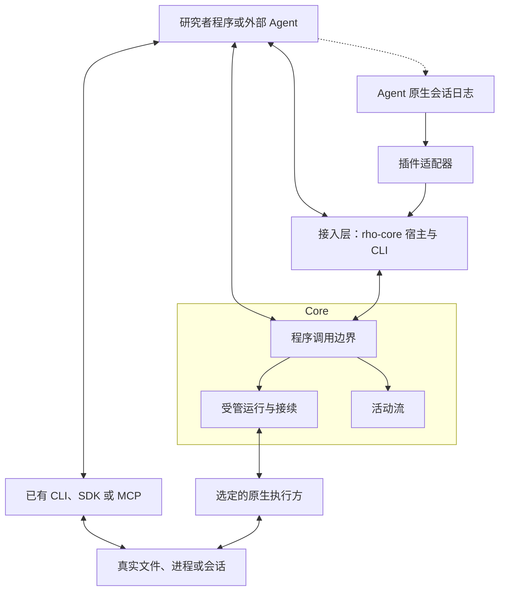

# Rho Core 架构

本文说明 Core 为什么存在、负责什么、与谁分工，以及怎样保护已受理工作和事实。已建成的
行为与限额见契约：[受管运行](MANAGED-RUN.md)、[信息模型](INFORMATION-MODEL.md)、
[宿主与 CLI](HOST-CLI.md) 与 [活动观测](ACTIVITY.md)。怎样推进工作见
[工程方法](ENGINEERING.md)，各部分现状见 [进度](PROGRESS.md)。

## Agent 怎样工作，Core 为什么存在

研究者提出问题；外部 Agent 在自己的环境中阅读材料与工具文档，选择方法，编写和组合
代码，直接使用已有的 CLI、SDK 和 MCP，再依据真实反馈继续。新方法可以是一段脚本或
一份使用说明，不必先成为 Core 的接口。换模型、换客户端或尝试新方法，通常不需要改 Core。

Agent 正常使用原生工具及其已有权限。Core 按具体需要选用，不是智能体计算的默认必经
路径；活动观测也不要求把被观察的动作改成受管运行。Core 提供：

- **受管运行**：让一次运行脱离某个等待者存活；调用方持有的请求身份保证重复送达
  （含并发）只受理、只派发一次；原请求、执行事实与有界输出可以找回；停止请求与停止
  确认分别表达；Core 重启后找回原记录而不重新派发。
- **活动观测**：保留插件适配器从外部 Agent 原生日志中选出的事件，连同来源身份、连续
  游标与保留缺口，供重读和后处理。Core 不控制、也不重放这些外部动作。

直接用 shell 做同一件事是对照基线：同一意图运行两次就派发两次；后台进程在等待者退出
后只剩进程号可找，没有请求关联、输出入口或停止确认（实测见
[受管运行](MANAGED-RUN.md#何时使用)与[宿主与 CLI](HOST-CLI.md#为什么需要常驻宿主)）。
原工具已经满足的工作继续用原工具。Core 不是把所有能力接入 Rho 的集成平台，也不是
另一个 Agent harness。

图中直接工具、接入层、适配器和原生执行方都在 Core 的逻辑边界之外。逻辑分离不要求
分开仓库、服务或 crate：`rho-core` 宿主与 CLI 和库在同一个包中，只使用库的公共 API。

## 职责分工

| 位置 | 负责 | 与 Core 的关系 |
| --- | --- | --- |
| 外部 Agent 环境 | 模型循环、提示与上下文、记忆、Skills、文档读取、工具选择、代码组合与停止策略 | 直接使用已有工具，需要受管保证时调用 Core；Core 不嵌入模型或编排器 |
| Core | 自己的程序边界、它受理的受管运行与接续、它收取的活动事件 | 只对自己受理或收取的内容负责 |
| 原生执行方与领域 Owner | 真实对象、语言会话、原生条件、读写与结果语义 | 在实际操作处检查可变前提；Core 复用其句柄与查询，不逐个翻译科研方法 |
| 接入层（当前为 `rho-core` 宿主与 CLI） | 命令行表达、连接、认证与传输限额 | 依赖 Core 的公共边界；Core 不依赖协议类型或客户端特性 |
| Rho-plugins | 功能组件、Agent 评估、原生日志读取与派生摘要 | 通过 Core 的公共 CLI 或库使用 Core |
| Rho 应用 | 组件选择、装配、窗口、布局与共享交互 | 在实际组合上验收 |
| 研究者 | 问题、方法取舍、解释与科学主张 | 执行回报不代替科学判断 |

当前部署是可信的单用户本地项目。远程访问、多用户与更强的隔离在有具体需求时再设计
并验证，见 [SECURITY](../SECURITY.md)。

## 何时使用 Core

| 动作 | 先用 | Core 增加价值的时候 |
| --- | --- | --- |
| 读取、搜索或编辑文件 | 已有文件工具与 Git | 通常不需要 |
| 使用 CLI、SDK、MCP 或尝试新方法 | Agent 环境直接调用原接口 | 动作需要脱离等待者存活、保护重复送达或之后找回结果，而原工具做不到 |
| 长时间计算 | 已有原生工具或任务系统 | 已有工具不能满足等待者离开、回复丢失或找回原执行的需要时，选择受管运行 |
| 事后理解 Agent 做了什么 | 原生会话日志 | 需要跨采集器中断和宿主重启保留、续读与重新处理选定活动 |

一个脚本可以组合多次调用，但每个受管运行只对自己的受理与效果负责。专用命令还是
代码组合更合适，在同一个真实任务上比较后决定。

## 固定的边界

保护的是已受理的工作、已有承诺和事实的诚实表达。依赖方向、身份由谁生成、存储和
调用方式是可以复核的设计选择，不能以“固定边界”要求所有智能体动作进入 Core。
改变机制时保留已有请求与证据；相应契约和测试随明确的改动更新。

1. **实际责任范围**：Core 对自己受理的运行和收取的活动负责。领域与原生语义留在
   实际 Owner；外部能力不必注册或包装成 Rho 插件。上面的依赖结构描述当前实现，
   不作为不可讨论的架构要求。
2. **已有请求的身份与承诺**：当前 API 由调用方持有身份，这一机制可以复核；已有
   受理不因设计调整而失去身份或去重保护。同身份同请求返回原受理，不再派发，包括并发送达；同身份
   不同请求被拒绝，原记录不变；有意再执行使用新身份。去重承诺不能因记录过期而悄悄
   失效：身份要么一直保留，要么明确报告过期，要么由显式删除释放。
3. **不确定不授权重跑**：回复丢失、超时、重连、重启或记录读不出，都不会导致自动执行
   或换新身份执行。补存已知事实、接续原生已有任务和重新执行是三种不同的动作。
4. **事实分别表达**：受理、派发、原生启动与结束、输出保留、取消请求、停止确认与资源
   释放各自报告；未知要说明未知的是哪一部分及依据。调用方在自己的范围内能取回继续
   所需的事实：原请求、已知状态、未知及其原因、结果入口和保证范围；记录缺失或读取
   失败也明确报告。不宣称外部 exactly-once；代码组合不产生跨调用事务；取消不等于回滚。
5. **受管与观察分开**：Core 的保证只覆盖它受理的动作，并写明成立的进程寿命、保留期限
   与平台。外部动作可以被观察和保留，但不因此获得受理、去重、因果历史或产物证明；
   Core 的记录与锁也不约束外部工具。
6. **范围与权限**：Core 在直接程序调用中同样检查自己的身份与访问范围。原生对象是否
   仍是原对象、是否忙碌、是否满足执行条件，由实际 Owner 在操作处判断；Core 的预检查
   不能消除检查与执行之间的变化。模型输出、工具描述和接入层都不能扩大权限。已授权的
   工作不再增加 Rho 审批。路径包含检查不是沙箱。
7. **读取只是观察**：读取有界，不启动、不恢复运行时，也不为普通读取建立历史。当前读到
   的内容不能冒充历史输入。
8. **自己持有的资源有界**：Core 持有的进程、记录、输出、连接与活动事件都有上限；每个
   上限写明保护的资源、默认值、配置方式和超限行为。超限时明确拒绝或标记缺口，不静默
   截断，不无限排队。Core 不为整个 Agent 环境做配额或监控。
9. **主张有证据**：只有实际执行的检查才算，每项只证明它记录的范围。重启、持久化与恢复
   行为经过对应的故障实验后才写成保证。执行完成、产物完整、领域检查与模型判断是不同
   的事实。

## 开放的部分

其余都由结果决定：下一项能力是什么、API 与命令形状、存储布局与格式、限额默认值、
内部模块与共享机制、性能取舍、测试组织、在哪些平台验证，以及何时需要 SDK、HTTP 或
MCP 入口、存储迁移或 CI。当前的选择在代码、契约与任务记录里，评审过的结果需要时
就改。怎样从结果推进见[工程方法](ENGINEERING.md)。
